<!-- readme-standard: 2026-11-02 -->
<div align="center">



# tmadealex.github.io

*A place being kept on the web. It asks for nothing, and the first step is a conversation.*

[](https://tmadealex.github.io/)


 **You are here:** TMadeAlex › `tmadealex.github.io` · public · `main` is the working branch

</div>

##  TL;DR

1.  **What this is.** A small website at [tmadealex.github.io](https://tmadealex.github.io/). Today it shows one quiet page that says a place is being kept. Nothing about anyone is written on it.
2.  **Who it is for.** TMade Alex. Christopher W ([@drasticstatic](https://github.com/drasticstatic)), a friend, set it up as a gift. Nothing here speaks for TMade Alex yet, and TMade Alex decides what stays.
3.  **Do this first.** Nothing. The first step is a conversation, and it has not happened yet. This page is the guide for the day someone wants one.

A website should sound like the person it speaks for, so this one waits. Everything below is how the place works and who holds the keys. None of it needs doing.

##  Change the words

Every word and every setting lives in one folder, [`src/data`](./src/data). Nothing else needs touching.

| To change | Open this file |
| --- | --- |
| The name, the line under it, the about paragraphs, what is offered, the contact links, the colours, the footer, the small words on buttons | [`src/data/site.ts`](./src/data/site.ts) |
| The list of work | [`src/data/work.ts`](./src/data/work.ts) |
| The list of pictures (the files themselves go in [`public/gallery/`](./public/gallery)) | [`src/data/gallery.ts`](./src/data/gallery.ts) |

Three settings in [`site.ts`](./src/data/site.ts) decide what the world sees:

| Switch | Today | What it does |
| --- | --- | --- |
| `ready` | `false` | While it is `false`, every address shows the one holding page. Change it to `true` and the real sections appear. |
| `indexable` | `false` | While it is `false`, search engines are told not to list the site. Change it to `true` when it should be found. |
| `supportAddress` and `supportNetwork` | empty | The support panel appears only when both are filled in: the owner's own address, and the network it is on, so nobody sends to the wrong one. While either is empty, the panel is not on the site at all. With both, it shows the address, the network and a button that copies the address. |

A section with nothing in it does not appear, so the site can be filled a little at a time.

**The examples.** In `site.ts`, `work.ts` and `gallery.ts`, each list holds an example whose lines start with two slashes (`//`). A line that starts with `//` is a note: it does not show on the site. To use an example, copy it, remove the two slashes at the start of each of its lines, and change the words between the quote marks.

**What is needed first.** A GitHub account, signed in, that is an owner of the [TMadeAlex organisation](https://github.com/orgs/TMadeAlex/people) (or that an owner has given write access to this repository). Without that, the pencil below is greyed out, or GitHub offers to make a copy instead of changing this one. An owner adds someone from **the organisation's people › Invite member**.

**In the browser, with the pencil.** No program to install:

1. Open the file on GitHub, for example [`src/data/site.ts`](./src/data/site.ts).
2. Press the pencil at the top right of the file (*Edit this file*).
3. Change the words between the quote marks. Leave the quote marks and the commas where they are.
4. Press **Commit changes…**, say in a few words what changed, and press **Commit changes** again.

**To add a picture:**

1. Make the picture about 2000 px on its long side, as a JPEG or WebP. For a quicker page, make a second copy about 800 px on its long side to use as its thumbnail. Give the files short names with no spaces, for example `harbour.jpg` and `harbour-thumb.jpg`.
2. Open [`public/gallery/`](./public/gallery), choose **Add file › Upload files**, drop the files in, and commit.
3. Open [`src/data/gallery.ts`](./src/data/gallery.ts) with the pencil, copy the example, remove its two slashes, and fill it in: `src` is `"/gallery/harbour.jpg"`, `thumb` is `"/gallery/harbour-thumb.jpg"`, and `width` and `height` are the full picture's size in pixels, so the grid keeps its shape. `alt` says what the picture shows, for someone who cannot see it.

Only put up a picture that is fine to stay public: see *Undo a change* below.

##  See it live

Every change to `main` starts a build. Open the [Actions](../../actions) tab to watch it. It takes about two minutes.

- **A green tick** means the change is live at [tmadealex.github.io](https://tmadealex.github.io/). If the old page still shows, refresh it.
- **A red cross** means the build stopped, usually over a missing quote mark or comma. Nothing breaks: the site that was live stays exactly as it was until a change builds cleanly.

##  Undo a change

Nothing is ever lost. GitHub keeps every version of every file.

That cuts both ways. While this repository is public, anyone can read those earlier versions, and anyone can copy the repository. Words, a picture or an address that were published and then undone stay readable in the history, and making the repository private later does not take back copies already made. So put up only what is fine to stay public.

1. Open the file and press **History** at the top right.
2. Open the version from before the change, and copy the old words.
3. Go back to the file, press the pencil, put the old words back, and commit.

A helper with the repository on a computer can do the same with `git revert <commit>`. That adds a new change that undoes the old one, and erases nothing.

##  Who owns this place

The TMadeAlex organisation on GitHub, and everything in it, is kept for TMade Alex, and it is TMade Alex's to own. An owner can change anything, add or remove people, and delete all of it.

Christopher W ([@drasticstatic](https://github.com/drasticstatic)) set it up and is a second owner, with his helpers Alfred (Claude Code) and Littlebird. He is a spare key, so the place never depends on one person. He adds nothing about anyone to this site.

##  Remove the second owner

The spare key can be taken back at any time, with no reason given and no hard feelings.

1. Open [the organisation's people](https://github.com/orgs/TMadeAlex/people).
2. Find `drasticstatic`, open the menu at the end of his row, and choose **Remove from organisation**.
3. Confirm. His helpers work under his account, so there is one name to remove.
4. To be thorough, open the organisation's **Settings › GitHub Apps** and remove any app that is not wanted.

GitHub keeps at least one owner on an organisation, so the last owner cannot be removed by mistake.

##  Take it all down

Three ways, from the lightest to the most final. Each needs only an owner.

1. **Take the site off the web and keep the files.** Two steps, in this order, because the next change to `main` would otherwise publish the site again:
   1. Stop the publishing. Open the [Actions](../../actions) tab, choose **Deploy to GitHub Pages** on the left, open the **…** menu at the top right, and choose **Disable workflow**.
   2. Open **Settings › Pages**, open the menu beside the live address, and choose **Unpublish site**.

   Or, in one step: **Settings › General**, down to the *Danger Zone*, **Change visibility › Make private**. On GitHub's free plan a private repository has no site, so the site comes down with it, and the files are then seen only by the people in the organisation. To bring the site back later, enable the workflow again (or make the repository public again) and run it from the Actions tab.
2. **Delete this repository.** **Settings › General**, down to the *Danger Zone*, **Delete this repository**. The site goes with it.
3. **Delete the whole organisation.** [The organisation's settings](https://github.com/organizations/TMadeAlex/settings/profile), down to the *Danger zone*, **Delete this organisation**. Every repository in it goes too.

##  What it never does

- No forms, no sign-in, no cookies, no analytics and no trackers.
- A visitor's browser asks this site for its files and asks no other site for anything. The fonts are built in when the site is built, the icons are part of the code, and no picture is loaded from elsewhere.
- The contact page is a list of links.
- The support panel shows an address and copies it. It does not connect to a wallet, hold anything, take a payment or mint anything.

##  How it is built

For a helper, or for the curious. Next.js 16, React 19, Tailwind 4 and TypeScript, written out as plain files and served by GitHub Pages.

```sh
npm ci                              # install, exactly as package-lock.json says
npm run lint
npm run build                       # writes the site to out/
python3 -I scripts/check-links.py   # every link and file in out/ resolves; nothing loads from, redirects to or posts to elsewhere
```

| Path | What it holds |
| --- | --- |
| [`src/data/`](./src/data) | Every word and setting |
| [`src/app/`](./src/app) | The pages: `/`, `/about/`, `/work/`, `/contact/` and the page for a wrong address |
| [`src/components/`](./src/components) | The holding page, the sections, the picture grid and viewer, the support panel |
| [`src/app/globals.css`](./src/app/globals.css) | The look. Every colour is mixed from the six values in `site.ts`, for light and dark |
| [`scripts/check-links.py`](./scripts/check-links.py) | The link check, in plain Python |
| [`.github/workflows/deploy.yml`](./.github/workflows/deploy.yml) | Builds and publishes on every change to `main` |
| [`AGENTS.md`](./AGENTS.md) | How any AI helper behaves here |

The picture viewer works from the keyboard: Escape closes it, the left and right arrows step through, Home and End go to the first and last, and closing it puts the keyboard back on the picture last shown. On a touch screen, swipe left or right. A screen reader hears the count, title and caption at each step. The grid loads each thumbnail only as it comes into view, and the full picture only when it is opened.

##  Suggest a change

Noticed something? Open an [issue](../../issues) or a pull request against `main`. Christopher reads them, the owner decides, and a person with the role merges with a merge commit, never a squash. Not on GitHub? Tell Christopher in your own words. Commit subjects start with one gitmoji ([GITMOJI.md](https://github.com/drasticstatic/my-template/blob/main/GITMOJI.md)); run `sh scripts/install-hooks.sh` once per clone.

<sub>The front door follows the living [README standard](https://github.com/drasticstatic/my-template/blob/main/README-STANDARD.md). No licence has been chosen for this repository: that is its owner's to decide. Icons: Lucide (ISC). Kept ready by the drasticstatic lab, as a gift.</sub>
